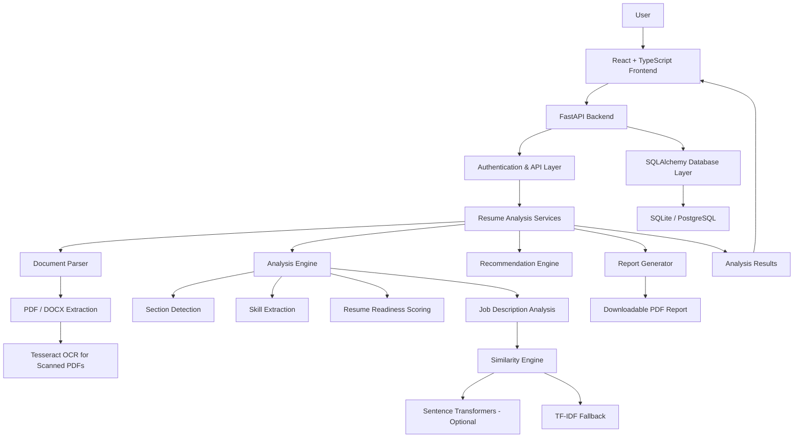

# ResumeIQ AI 🚀

### Intelligent Resume Analysis & Career Optimization Platform

ResumeIQ AI is a local-first, AI-powered resume analysis platform designed to evaluate resume structure, identify technical skills, assess resume readiness, and analyze alignment with specific job descriptions.

Developed using **Python, FastAPI, React.js, TypeScript, and Machine Learning**, the application processes PDF and DOCX resumes, extracts relevant information, identifies categorized skills, and generates transparent, evidence-based resume assessments.

It combines document processing, rule-based NLP techniques, explainable scoring, job-description skill analysis, and optional semantic similarity models to provide actionable insights through an interactive dashboard.

---

## ✨ Key Features

* **Resume Parsing:** Extract text and information from PDF and DOCX documents.
* **OCR Support:** Process scanned and image-based PDFs using Tesseract OCR.
* **Skill Extraction:** Identify and categorize technical skills using configurable skill dictionaries and normalized aliases.
* **Resume Section Detection:** Identify important resume sections and evaluate their completeness.
* **Resume Readiness Scoring:** Generate an explainable, deterministic assessment using a 100-point scoring framework.
* **Job Description Analysis:** Analyze job requirements and identify relevant skills.
* **Skill Gap Analysis:** Identify matching and missing skills between resumes and job descriptions.
* **Semantic Matching:** Optional Sentence Transformers integration using the `all-MiniLM-L6-v2` model.
* **TF-IDF Fallback:** Perform lexical similarity analysis when optional semantic model dependencies are unavailable.
* **Improvement Recommendations:** Generate evidence-based suggestions for improving resume quality.
* **Professional Summary Drafting:** Generate conservative professional summary drafts.
* **Bullet Point Optimization:** Improve resume bullet points without inventing achievements.
* **Analytics Dashboard:** Visualize resume analysis results and historical performance.
* **Analysis History:** Maintain session-specific analysis records.
* **PDF Report Generation:** Download detailed, paginated resume analysis reports.

---

## 🏗️ System Architecture

ResumeIQ AI follows a modular full-stack architecture that separates frontend presentation, backend API processing, document analysis, NLP operations, and database management.

### Architecture Overview



### Architecture Components

**1. Presentation Layer – React + TypeScript**

Provides the responsive user interface, resume upload functionality, analysis dashboard, historical records, charts, and downloadable reports.

**2. API Layer – FastAPI**

Handles frontend-backend communication, request validation, guest authentication, bearer-token verification, analysis endpoints, and API responses.

**3. Document Processing Layer**

Uses PyMuPDF and python-docx to extract text from uploaded documents. Tesseract OCR provides text extraction for scanned PDFs when installed.

**4. NLP and Analysis Layer**

Performs resume section detection, categorized skill extraction, text analysis, job-description comparison, readiness scoring, and evidence-based recommendations.

**5. Similarity Engine**

Supports optional Sentence Transformers using `all-MiniLM-L6-v2`. When the optional ML dependencies are unavailable, the system uses TF-IDF lexical similarity as a fallback.

**6. Data Persistence Layer**

Uses SQLAlchemy for database interaction, with SQLite as the default database and PostgreSQL support through database configuration.

**7. Reporting Layer**

Uses ReportLab to generate downloadable PDF reports containing analysis scores, extracted information, skill evidence, and recommendations.

---

## 🛠️ Technology Stack

| Category            | Technologies                   |
| ------------------- | ------------------------------ |
| Frontend            | React.js, TypeScript           |
| Backend             | Python, FastAPI                |
| API Server          | Uvicorn                        |
| Machine Learning    | Scikit-learn                   |
| NLP & Similarity    | Sentence Transformers, TF-IDF  |
| Document Processing | PyMuPDF, python-docx           |
| OCR                 | Tesseract, Pytesseract, Pillow |
| Data Processing     | NumPy, Scikit-learn            |
| Database            | SQLite, PostgreSQL             |
| ORM                 | SQLAlchemy                     |
| Validation          | Pydantic                       |
| PDF Generation      | ReportLab                      |
| Testing             | Pytest, HTTPX                  |
| Configuration       | Python-dotenv                  |

---

## 📂 Project Structure

```text
ResumeIQ-AI/
│
├── backend/
│   ├── app/
│   │   ├── core.py
│   │   ├── database.py
│   │   ├── main.py
│   │   ├── models.py
│   │   │
│   │   └── services/
│   │       ├── analysis.py
│   │       └── document_parser.py
│   │
│   └── tests/
│       ├── test_analysis.py
│       ├── test_api.py
│       └── test_document_parser.py
│
├── frontend/
│   └── src/
│       ├── App.tsx
│       ├── main.tsx
│       ├── report.css
│       └── style.css
│
├── requirements.txt
├── requirements-ml.txt
├── .env.example
├── .gitignore
└── README.md
```

---

## ⚙️ Installation & Setup

### Prerequisites

* Python 3.12
* Node.js and npm
* Git
* Visual Studio Code

### 1. Clone the Repository

```bash
git clone YOUR_GITHUB_REPOSITORY_URL
cd ResumeIQ-AI
```

### 2. Create a Python Virtual Environment

```powershell
py -3.12 -m venv .venv
```

Activate it:

```powershell
.\.venv\Scripts\Activate.ps1
```

### 3. Install Backend Dependencies

```bash
python -m pip install -r requirements.txt
```

### 4. Configure Environment Variables

```powershell
Copy-Item .env.example .env
```

Configure a strong `RESUMEIQ_SECRET_KEY` in your `.env` file.

### 5. Start the Backend

```bash
uvicorn backend.app.main:app --reload --env-file .env
```

Backend:

`http://localhost:8000`

API Documentation:

`http://localhost:8000/docs`

### 6. Start the Frontend

Open another terminal:

```powershell
cd frontend
npm install
npm run dev
```

Frontend:

`http://localhost:5173`

---

## 🤖 Optional Machine Learning Setup

ResumeIQ AI supports an optional Sentence Transformers integration.

Install the additional dependencies:

```bash
python -m pip install -r requirements-ml.txt
```

The configured model is:

`sentence-transformers/all-MiniLM-L6-v2`

The model runs on CPU and its weights may download during the first use.

If the optional dependency is unavailable, the application uses a TF-IDF lexical similarity fallback.

---

## 🧪 Testing

Run backend automated tests:

```bash
python -m pytest backend\tests -q
```

Build the frontend:

```bash
cd frontend
npm run build
```

The automated tests cover document analysis, PDF and DOCX processing, scanned-PDF OCR fallback, skill aliases, guest-session data isolation, analysis history, and PDF report generation.

---

## 🔐 Security & Data Handling

* File-signature validation for uploaded documents.
* Maximum upload size of 5 MB.
* Guest sessions with signed bearer tokens.
* Session-specific analysis history.
* Ownership checks for protected API operations.
* Uploaded files are processed in memory.
* Analysis results are saved instead of uploaded documents or complete extracted resume text.
* Environment-based secret configuration.

---

## ⚠️ Current Project Scope & Limitations

ResumeIQ AI is a functioning local-first MVP.

The current implementation uses transparent skill dictionaries and section-detection heuristics. Its summary and bullet-point tools generate conservative deterministic drafts rather than relying on an external LLM.

Features such as resume comparison, job-role recommendations, password reset, email verification, persisted job descriptions, Alembic migrations, rate limiting, and deployment manifests are not yet implemented.

Resume readiness scores are internal heuristic assessments, not official ATS scores or predictions of hiring outcomes.

---

## 🔮 Future Enhancements

* Advanced contextual skill extraction.
* Expanded semantic job matching.
* Resume version comparison.
* Personalized job-role recommendations.
* Enhanced recommendation generation.
* Production database migrations.
* Additional automated integration and accessibility testing.
* Production deployment and monitoring.

---

## 👨‍💻 Project Information

**Project Name:** ResumeIQ AI

**Domain:** Artificial Intelligence | Machine Learning | Natural Language Processing | Full-Stack Development

**Primary Languages:** Python, TypeScript

**Development Environment:** Visual Studio Code

**Project Type:** AI-Powered Resume Analysis Platform

---

### ResumeIQ AI

**Analyze Smarter. Improve Your Resume. Move Your Career Forward.**
